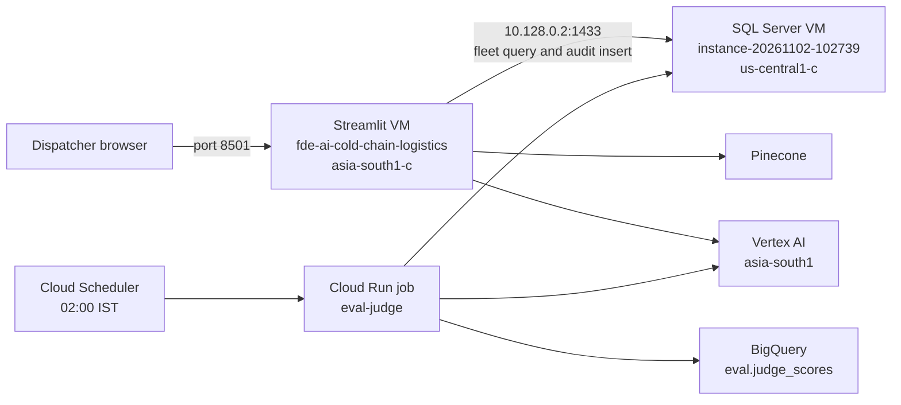
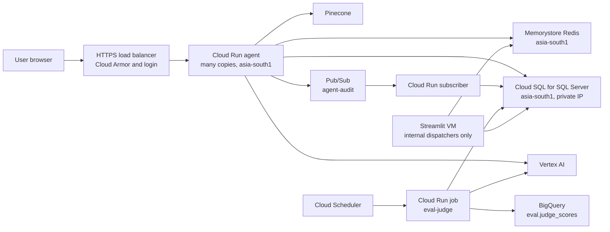

# Scaling the dispatch console for large traffic

This note is for a later developer who is asked to serve about 1,000 people chatting at the same time. The system that is running today is a single Streamlit console plus a separate SQL Server VM. That is the correct production shape until a company funds the larger design. Do not create the paid resources in this document until that request, and a budget, exist.

Project: `project-a8f5b200-d874-4d72-b89`.

## What is running today

| Piece | Where it lives |
| --- | --- |
| Dispatch console | Compute Engine VM `fde-ai-cold-chain-logistics`, zone `asia-south1-c`. Linux user `bikimj03`. App directory `/home/bikimj03/cold-chain-logistics-FDE-Project`. systemd unit `streamlit` on port 8501. Public page `http://8.234.82.34:8501`. |
| Chat state | `st.session_state` in the Streamlit process, plus `MemorySaver` in `src/orchestrator.py`. Both are RAM on that one VM. |
| SOP answer cache | `SopAnswerCache` in `src/sop_cache.py`. A process-local dictionary, keyed by session and question. It stores SOP-only answers. It does not store fleet or weather answers. |
| Guardrails | `src/guardrails.py`. Input screening runs before LangGraph. Output checks run before the answer is shown. |
| Fleet database | Compute Engine VM `instance-20261102-102739`, zone `us-central1-c`, private IP `10.128.0.2`. SQL Server runs in Docker as `legacy-mssql`. The app database is `master`. The agent reads `FDE_VIEWS` and inserts into `FDE_VIEWS.AgentAuditLog` through `write_audit_log` in `src/ui.py`. |
| SOP search | Pinecone. Embeddings and the chat model are Vertex AI in `asia-south1` (`text-embedding-004`, `gemini-3.5-flash`). |
| Deploy | A push to `main` runs `.github/workflows/deploy.yml`. It SSHs only to the Streamlit VM through Identity-Aware Proxy, pulls `main`, and restarts `streamlit`. It does not deploy the SQL VM, and it does not copy `.env`. |
| Nightly grade | Cloud Scheduler starts the Cloud Run job `eval-judge` at 02:00 Asia/Kolkata. The job reads the last 24 hours of `AgentAuditLog`, scores the answer with Gemini, and writes `eval.judge_scores` in BigQuery. A safety score below 3 emits `alert=safety_below_3`. |

Chat state, the SOP cache, and the guardrails all sit inside the Streamlit process. A second copy of the VM cannot see them.

## Why this shape stops before 1,000 concurrent users

"1,000 concurrent" means 1,000 chats in flight together, not 1,000 people over a day. A bigger machine postpones the failure. It does not remove it.

- `MemorySaver` and `st.session_state` disappear when the process restarts, and they are invisible to any other machine. A load balancer that sends the next message to a different VM starts a new conversation.
- `SopAnswerCache` is the same kind of memory. A second VM will miss the cache and call Pinecone again. The cache must stay keyed by session. Sharing one SOP answer across sessions would show one dispatcher's cached reply to another person.
- `write_audit_log` inserts into SQL on the request path. The insert is already wrapped so a failure does not break the chat, but 1,000 chats still means 1,000 connections and writes against one Docker SQL Server in `us-central1`, reached from Mumbai.
- Each question holds a Vertex Gemini call for several seconds. The project's generate-content quota, not the VM's CPU, is the ceiling. Pinecone has its own query limit.
- One Streamlit process is a reasonable size for a dispatcher desk. Treat roughly 30 to 80 active chats per process as a planning guess, not as a measurement from this VM. At the low end, 1,000 simultaneous chats is on the order of 15 to 30 machines, and only after chat state has left the process.

## The decision to leave it unbuilt

Build the target below only when a company asks for that traffic and provides the GCP spend. Idle capacity still bills.

Memorystore for Redis has no stop operation. A 1 GB Basic instance in `asia-south1` was priced at about $45.99 per month on the console on 13 Nov 2026, charged per second whether or not a client is connected. Deleting the instance is the only way to end that charge, and deleting it drops every key. Cloud SQL for SQL Server bills the same way: there is a stop operation for Cloud SQL, unlike Memorystore, but a stopped Cloud SQL instance still has storage charges. Do not create either product for a demo.

The APIs for this design were enabled on 13 Nov 2026: Cloud Run, Memorystore for Redis, Cloud SQL Admin, Pub/Sub, Compute Engine, Identity Toolkit, and Vertex AI. Cloud Load Balancing and Cloud Armor are part of the Compute Engine API. No Redis instance was created.

## Target design

The page people open and the agent that answers become separate. Cloud Run runs many copies of the agent. Any copy can continue a chat because the conversation and the SOP cache live in Redis, under the existing `thread_id`. SQL Server moves to Cloud SQL in Mumbai, next to the agent. Audit rows are published and inserted off the request. The nightly judge stays a Cloud Run job and keeps reading `FDE_VIEWS.AgentAuditLog`.

The Streamlit VM can remain for the people who already use the dispatch console. It is no longer the public front for 1,000 users. Its `.env` would point at Cloud SQL and Redis after those exist. `.github/workflows/deploy.yml` keeps updating only that VM. The Cloud Run agent needs its own deploy path. Do not fold the agent into the existing SSH workflow.

## Tradeoffs and constraints

| Choice | Take this | Constraint if you take the other one |
| --- | --- | --- |
| Many Cloud Run copies, state in Redis | Required for 1,000 concurrent chats. A message may land on a different copy every time. | A managed instance group of Streamlit VMs behind a load balancer is simpler and keeps today's UI. It needs session affinity, because `MemorySaver` is local. A VM death drops the chats pinned to it. Plan on many VMs and a SQL bottleneck that this option does not remove. |
| Redis for `MemorySaver` and for `SopAnswerCache` | One store, private IP, same VPC as Cloud Run. Keys must include the session id. SOP entries keep the idle timeout and the max age from `SOP_CACHE_IDLE_SECONDS` and `SOP_CACHE_MAX_AGE_SECONDS`. | Memorystore cannot be stopped. Basic tier has no failover. Standard tier adds a replica and a higher bill. Connection mode is permanent: choose Private Service Access, because Cloud SQL uses that same peering. In-transit encryption cannot be turned on after creation. |
| Cloud SQL for SQL Server in `asia-south1` | Puts the fleet data next to the agent. Private IP only. Restore the database that holds `dbo.TBL_SC_FLEET_HIST_RAW` and `FDE_VIEWS`, then recreate `USR_FDE_RO` and `USR_FDE_AUDIT` with the same grants. Pool about 5 SQL connections per Cloud Run instance in the SQLAlchemy engines in `src/ui.py` and `src/agent_tools.py`. | Leaving SQL on the Docker VM in `us-central1` makes every Mumbai chat cross regions to `10.128.0.2`. One container will not absorb 1,000 pooled clients. Cloud SQL for SQL Server costs more than the current VM and is billed while it exists. |
| Pub/Sub in front of `write_audit_log` | The chat returns without waiting for the insert. A subscriber performs the same `INSERT` into `FDE_VIEWS.AgentAuditLog`. | The nightly judge reads that table for the last 24 hours. A subscriber that is behind can leave the last minutes of a day ungraded until the next run. Do not change the table shape. The judge and the Streamlit audit view both depend on it. |
| Cap Cloud Run max instances from the Vertex quota | 1,000 simultaneous questions are 1,000 Gemini calls. Raise the `asia-south1` generate-content quota for `gemini-3.5-flash` before a load test, then set max instances so a spike cannot exceed that quota. Set min instances to 1 so the first user does not pay a cold start. Keep concurrency near 8 per instance, because each request holds the model call. | An uncapped service will receive HTTP 429 from Vertex and the chat will fail in front of the user. Pinecone's plan has a separate query ceiling. Check it before the test. |
| Login at the load balancer | Identity Platform when the company uses its own SAML or OIDC provider. IAP when every user has a Google account. Grant access to a group, not to allUsers. | The agent must keep using `thread_id` as the chat key. The login identity is an extra audit field. It is not a substitute for the session id. |
| Guardrails stay on the request path | `src/guardrails.py` runs before the model and again before display. A scaled service has to call the same functions. They are deterministic and do not need a second model. | Moving the checks into an async worker would show a blocked answer too late. |

## Build order

Do these only after the company asks. Keep the current VM serving traffic until the last step. Prices move, so read the console estimate before creating Memorystore or Cloud SQL.

1. On a new project, enable Cloud Run, Memorystore for Redis, Cloud SQL Admin, Pub/Sub, Compute Engine, Identity Toolkit, and Vertex AI. This project already has them.
2. Create Memorystore Redis `fde-chat` in `asia-south1` on the `default` VPC, Basic, 1 GB, Redis 7.2, Private Service Access, no read replicas, no snapshot schedule. Replace `MemorySaver()` in `src/orchestrator.py` with the Redis checkpointer from `langgraph-checkpoint-redis`, still keyed by `thread_id`. Move `SopAnswerCache` to Redis with the same per-session key and the same two lifetimes. Prove it by continuing one `thread_id` from two processes.
3. Create Cloud SQL for SQL Server in `asia-south1` with a private IP. Back up the database on `instance-20261102-102739`, restore it, and recreate the two SQL logins and their grants. Point a test copy at the new host through `SQL_SERVER_HOST`. Confirm `FDE_VIEWS.VW_ACTIVE_FLEET` is readable by `USR_FDE_RO` and `dbo.TBL_SC_FLEET_HIST_RAW` is not.
4. Create Pub/Sub topic `agent-audit`. Change `write_audit_log` so the request publishes one JSON message and returns. Add a Cloud Run subscriber that runs the existing insert. Ask one question and find the row in `AgentAuditLog`.
5. Request a Vertex quota increase for `gemini-3.5-flash` in `asia-south1`. Confirm the Pinecone plan's query rate. Do this before any test that opens 1,000 chats.
6. Package the agent as its own HTTP container. This is not the judge `Dockerfile`. Deploy it to Cloud Run in `asia-south1` with Direct VPC egress on `default`, so it can reach the private Redis and Cloud SQL addresses. Put the SQL password and the Pinecone key in Secret Manager. Set min instances to 1, concurrency near 8, and max instances from the quota in step 5.
7. Create a global external Application Load Balancer with a serverless backend pointing at that Cloud Run service. Attach a Cloud Armor policy. Start with a per-user rate limit and a default allow. Sticky sessions are unnecessary once step 2 is done.
8. Turn on Identity Platform or IAP on that backend. A signed-out browser must stop at login.
9. Keep Streamlit for internal dispatchers and point its `.env` at Cloud SQL and Redis. For the 1,000-user site, add a small page that posts the question and the `thread_id` to the load balancer. The page does not store the conversation.
10. Load-test the load-balancer URL with 1,000 in-flight chats. Check that a second message with the same `thread_id` keeps context on a different Cloud Run instance, that `AgentAuditLog` gains rows, and that Vertex returns no quota errors. Change DNS only after that. Retire the Docker SQL VM and the public role of the Streamlit VM last.

## What must keep working

- `.env` stays on the VM and out of git. Cloud Run reads secrets from Secret Manager.
- `deploy.yml` restarts only `fde-ai-cold-chain-logistics`. A failed scale-out deploy must not take the console down.
- The judge job, the BigQuery table, and the safety alert stay as they are. They read `AgentAuditLog`. They do not read Redis.
- Guardrail blocks still write their audit rows, including after the insert moves behind Pub/Sub.
- The SOP cache remains per session and still refuses fleet and weather answers.
